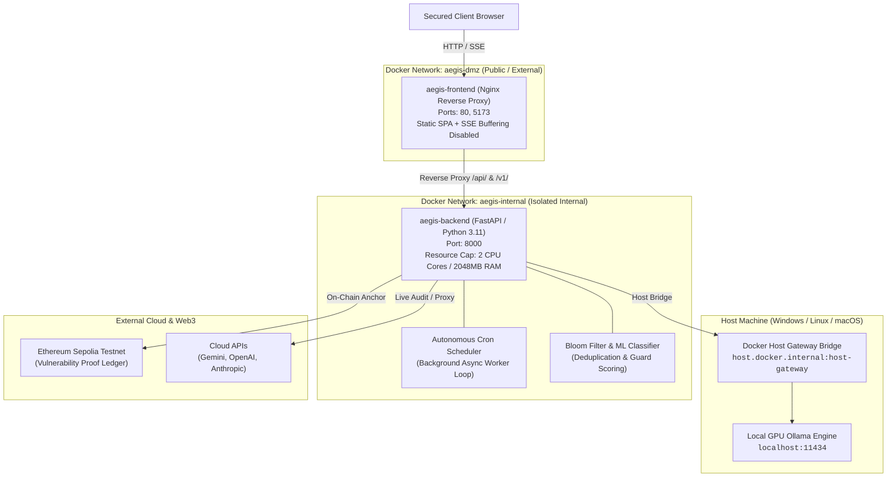

# AEGIS Deployment & Production Architecture Guide

This document details the multi-container production deployment, network topology, resource constraints, autonomous background cron worker, and security isolation practices for **AEGIS** (Autonomous AI Red-Teaming & Live Inference Defense Shield).

---

## 1. System Architecture & Topology

AEGIS uses a containerized dual-tier architecture isolating external client traffic from the internal red-teaming and defense engines, with automated host-gateway bridging for local GPU inference:



---

## 2. Resource Constraints & Container Limits

In accordance with Phase 7 security specifications, the red-team execution engine and inference proxy operate under strict resource ceilings defined in `docker-compose.yml`:

| Service | CPU Limit | Memory Limit | CPU Reservation | Memory Reservation |
|---|---|---|---|---|
| `aegis-backend` | **2.0 Cores** | **2048 MB (2 GB)** | 0.5 Cores | 512 MB |
| `aegis-frontend` | Uncapped (Lightweight Nginx) | Uncapped (<30 MB typical) | — | — |

These limits prevent rogue mutation generation or adversarial fuzz loops from consuming host resources or starving the host GPU during concurrent scans.

---

## 3. Host-Gateway Routing for Local Ollama

To allow containerized red-team agents to probe local GPU models without requiring public exposure or complex networking, `docker-compose.yml` configures an `extra_hosts` bridge:

```yaml
extra_hosts:
  - "host.docker.internal:host-gateway"
environment:
  - OLLAMA_HOST=http://host.docker.internal:11434
```

This routes all internal `ollama/*` traffic directly to the host machine's Ollama daemon at `http://host.docker.internal:11434`.

---

## 4. Multi-Stage Frontend Build & Nginx Reverse Proxy

The frontend uses a two-stage Docker build:
1. **Builder Stage (`node:20-alpine`)**: Injects `VITE_API_URL=""` at compile time and runs `npm run build`.
2. **Production Stage (`nginx:alpine`)**: Copies the compiled static assets into `/usr/share/nginx/html` and proxies `/api/` and `/v1/` calls to `http://aegis-backend:8000`.

### SSE Stream Passthrough
In `frontend/nginx.conf`, real-time scan telemetry (`/api/scan/stream`) has buffering explicitly disabled:
```nginx
proxy_buffering off;
proxy_cache off;
proxy_set_header Connection '';
proxy_http_version 1.1;
chunked_transfer_encoding on;
```
This guarantees zero latency for incoming Server-Sent Events (SSE).

---

## 5. Autonomous Background Cron Scheduler (Option B)

AEGIS features an autonomous background daemon (`AutonomousScheduler` in `backend/aegis/core/scheduler.py`) running concurrently with the FastAPI ASGI event loop.

### Lifecycle Management
- **Startup**: Triggered automatically in FastAPI `lifespan` on server boot.
- **Dynamic Frequency**: Automatically reads schedule interval from `backend/data/settings.json` (`hourly`, `every_6h`, `daily`, or `manual`).
- **Immediate Reload**: Saving settings via `POST /api/settings` immediately notifies the running daemon without requiring a server reboot.
- **Audit Execution**: Runs mutations in a worker thread (`run_in_executor`) to prevent blocking the async event loop, automatically dedupes via Bloom filter, and anchors confirmed breaches to Ethereum Sepolia.
- **Manual Trigger**: An audit sweep can be initiated on-demand at any time via `POST /api/scheduler/trigger` or using the **"Run Sweep Now"** button in **Settings**.

### Scheduler API Reference
| Endpoint | Method | Description |
|---|---|---|
| `/api/scheduler/status` | `GET` | Returns scheduler health, active frequency, next run time, and total runs completed |
| `/api/scheduler/trigger` | `POST` | On-demand trigger of an autonomous red-team sweep against targets |

---

## 6. Strict Environment & Private Key Isolation

### Step 1: Copy Environment Template
```bash
cp .env.example .env
```

### Step 2: Populate Secrets
Edit `.env` with your preferred credentials:
```ini
OPENAI_API_KEY=sk-...
GEMINI_API_KEY=AIzaSy...
ANTHROPIC_API_KEY=sk-ant-...

SEPOLIA_RPC_URL=https://rpc.sepolia.org
PRIVATE_KEY=0x...
```

> [!CAUTION]
> **STRICT PRIVATE KEY SECURITY:**
> 1. AEGIS stores on-chain hashes of confirmed vulnerabilities on Ethereum Sepolia.
> 2. Use a dedicated testnet developer wallet. **NEVER** use a wallet with mainnet funds.
> 3. `.env` and `backend/data/settings.json` are listed in `.gitignore` and `.dockerignore`. Never commit them to a public git repository.

---

## 7. Quickstart Commands

### 1-Click Launch with Docker Compose
```bash
# Build and launch all services in detached mode
docker compose up -d --build

# Monitor live container status
docker compose ps

# View backend logs and scheduler telemetry
docker compose logs -f aegis-backend
```

### Accessing the Web Interfaces
- **AEGIS Web Dashboard**: [http://localhost:5173](http://localhost:5173) (or [http://localhost:80](http://localhost:80))
- **Defense Monitor & Live Proxy**: [http://localhost:5173/defense](http://localhost:5173/defense)
- **Zero-G Attack Lineage**: [http://localhost:5173/lineage](http://localhost:5173/lineage)
- **System Settings & Scheduler**: [http://localhost:5173/settings](http://localhost:5173/settings)
- **FastAPI Interactive Docs**: [http://localhost:8000/docs](http://localhost:8000/docs)

### Stopping the Services
```bash
docker compose down
```

---

## 8. Verification & Health Monitoring

### Service Health Checks
```bash
# Backend health endpoint
curl -f http://localhost:8000/health

# Scheduler status
curl -s http://localhost:8000/api/scheduler/status

# Test defense guard via proxy
curl -X POST http://localhost:8000/v1/chat/completions \
  -H "Content-Type: application/json" \
  -d '{"model": "mock", "messages": [{"role": "user", "content": "Explain quantum computing."}]}'
```

### Running Test Suites Locally
```bash
# Run complete backend pytest suite (102 tests)
cd backend
python -m pytest

# Run live system integration test suite
python verify_live_system.py
```
